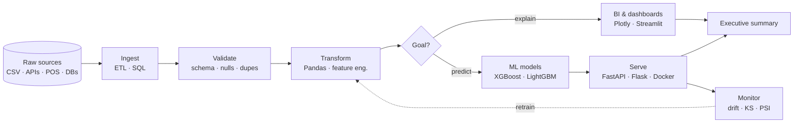
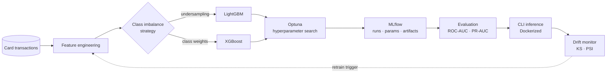
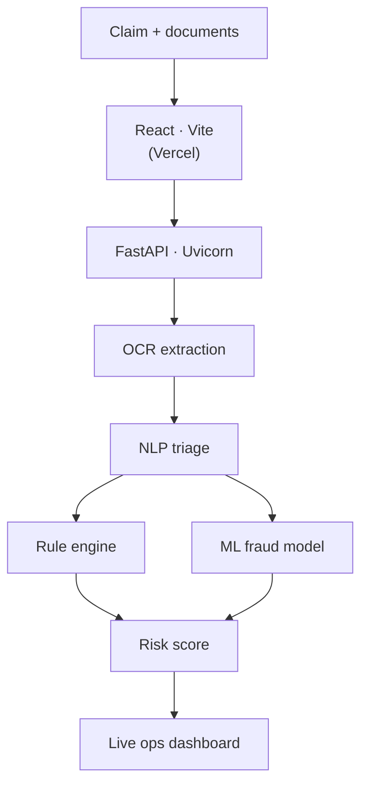
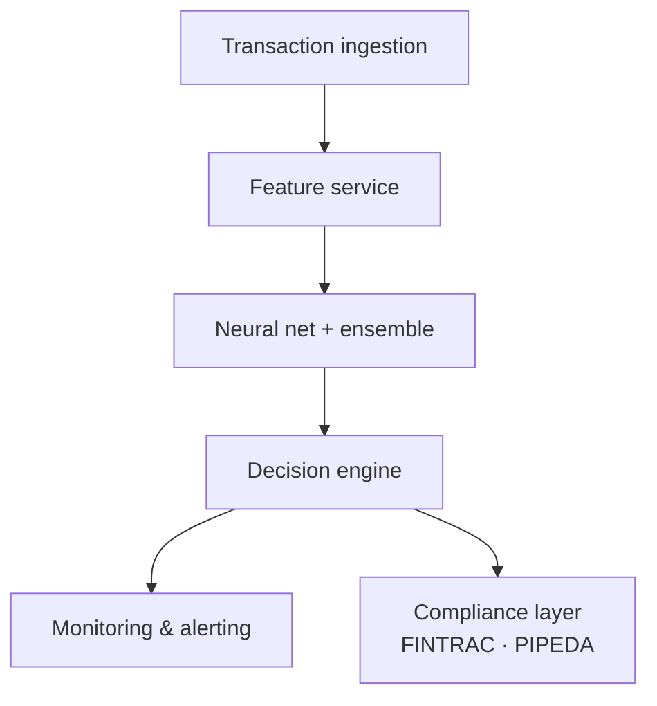
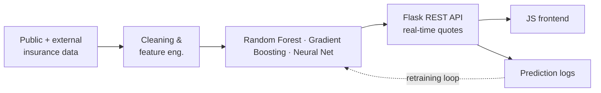
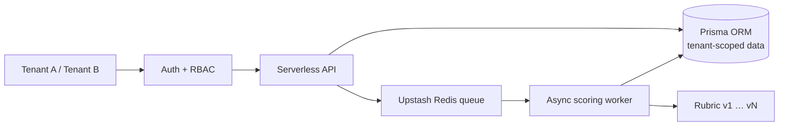

<!-- ===================== HEADER ===================== -->
<div align="center">
  
</div>

<div align="center">
  
</div>

<p align="center">
  <a href="https://linkedin.com/in/Wesleyharuo"></a>
  <a href="https://github.com/wesleyharuo?tab=repositories"></a>
  
</p>

<br>

<!-- ===================== ABOUT ===================== -->
<table>
<tr>
<td width="56%" valign="top">

### 👋 Hey, I'm Wesley

I like the part of a data project most people skip: figuring out **what question the business is actually asking**, then building the pipeline, the model, and the one-page summary that answers it.

```python
class Wesley(DataEngineer, DataAnalyst):
    focus    = ["data detection", "forecasting", "BI"]
    ships    = ["pipelines", "models", "APIs", "exec summaries"]
    learning = ["Spark", "Airflow", "dbt", "AWS", "LLMs"]

    def deliver(self, data):
        return self.insight(data) >> "decision"
```

</td>
<td width="44%" valign="top">

### ⚡ Quick facts

- 🔍 **18+ public projects** across analytics, ML and full-stack
- 🛡️ Fraud systems with **drift monitoring** (KS · PSI) and **FINTRAC / PIPEDA**-aware design
- 🧪 Experiment tracking with **MLflow**, tuning with **Optuna**
- 📊 Every analysis ships with an **executive summary**, not just charts
- 🚀 Live on Vercel: [AI Hub](https://ai-hub-nine-kappa.vercel.app) · [Cop](https://cop-three.vercel.app)

</td>
</tr>
</table>

<!-- ===================== HOW I BUILD ===================== -->
## 🏗️ How I build data products



<!-- ===================== STACK ===================== -->
## 🧰 Stack by layer

<p align="center">
  
</p>

| Layer | Tools |
|---|---|
| **Ingestion & ETL** |    |
| **Storage** |     |
| **Modeling** |      |
| **MLOps** |     |
| **Serving & APIs** |    |
| **Visualization & BI** |     |
| **Frontend** |     |
| **Leveling up** |      |

<!-- ===================== FLAGSHIP: CARDGUARD ===================== -->
## 🛡️ Flagship — [CardGuard](https://github.com/wesleyharuo/CardGuard-) · Credit Card Fraud Detection

<!-- TODO: add your real metrics here, e.g.


-->
<!-- TODO: add a chart, e.g.  -->



| Engineering decision | Why |
|---|---|
| **PR-AUC as primary metric** | Fraud is a tiny minority class; ROC-AUC can look excellent even when the model misses most fraud. PR-AUC exposes that. |
| **Undersampling vs. class weighting, both tested** | Each trades off differently between recall and false alarms, so they're benchmarked instead of assumed. |
| **KS + PSI drift checks** | Fraud patterns change. These flag when production data stops looking like training data, before accuracy silently degrades. |
| **Modular `data → features → models → evaluation`** | Each stage is swappable and testable on its own, the way it would live in production. |

<!-- ===================== RISK & INSURANCE AI ===================== -->
## 🧠 Risk & Insurance AI

<table>
<tr>
<td width="50%" valign="top">

### [KW Risk](https://github.com/wesleyharuo/KW_Risk)
Insurance claims intake, triage and fraud screening.



**Hybrid scoring:** rules catch known patterns and stay explainable; ML catches what rules miss.

</td>
<td width="50%" valign="top">

### [AI Fraud Detection Canada](https://github.com/wesleyharuo/AI-Fraud-Detection-Canada)
Fraud platform designed around Canadian financial regulation.



**Microservices**, so models, decisioning and alerting scale and deploy independently.

</td>
</tr>
<tr>
<td colspan="2">

### [Insurance Premium ML](https://github.com/wesleyharuo/Data_insurance_IA_ML_Insurance)



</td>
</tr>
</table>

<!-- ===================== ANALYTICS ===================== -->
## 📊 Analytics & Business Intelligence

<table>
<tr>
<td width="33%" valign="top" align="center">

#### [☕ Maple Cafe Sales](https://github.com/wesleyharuo/maple-cafe-sales)


3 locations · full year 2024<br/>
Revenue by hour × location × category → staffing & menu decisions

</td>
<td width="33%" valign="top" align="center">

#### [🏔️ Maple Outfitters](https://github.com/wesleyharuo/maple-outfitters)


5 sales channels<br/>
Retention, returns & discount impact → multi-channel strategy

</td>
<td width="33%" valign="top" align="center">

#### [🏙️ GTA Rental Market](https://github.com/wesleyharuo/gta-rental-market)


10 neighborhoods<br/>
Pricing gaps, vacancy & absorption → investment signals

</td>
</tr>
<tr>
<td width="33%" valign="top" align="center">

#### [📈 Predicta Suite](https://github.com/wesleyharuo/Predicta_Suite)
Prophet **vs** ARIMA **vs** scikit-learn<br/>
Automated benchmarking for seasonal forecasting

</td>
<td width="33%" valign="top" align="center">

#### [⚙️ Process Improvement Platform](https://github.com/wesleyharuo/Process-Improvement-Data-Analytics-Platform)
Streamlit + SQL dashboards<br/>
Retail · supply chain · customer support

</td>
<td width="33%" valign="top" align="center">

#### [📐 Calc Vector](https://github.com/wesleyharuo/Calc_Vector)
NumPy · SciPy · Plotly<br/>
Live 2D/3D vector math in Streamlit

</td>
</tr>
</table>

<!-- ===================== PRODUCTS ===================== -->
## 🌐 Products & Platforms

<table>
<tr>
<td width="58%" valign="top">

### [Resume Evaluator SaaS](https://github.com/wesleyharuo/Aplicaton-new)
Multi-tenant platform that scores resumes against versioned rubrics.



**Why a queue:** scoring is slow and bursty, so requests return instantly and workers absorb the load.

</td>
<td width="42%" valign="top">

### 🚀 Live demos

<a href="https://ai-hub-nine-kappa.vercel.app"></a><br/>
<sub>Interactive AI tools & data viz hub</sub>

<a href="https://cop-three.vercel.app"></a><br/>
<sub>Multi-model chat copilot via OpenRouter</sub>

<br/>

**Also built:** [DigitalMenuHub](https://github.com/wesleyharuo/DigitalMenuHub) (QR menus + analytics) · [Lex](https://github.com/wesleyharuo/lex) (PHP + PostgreSQL file server) · [QuickStats Web](https://github.com/wesleyharuo/QuickStats-Web) · [Model Dig MKT](https://github.com/wesleyharuo/Model_Dig_MKT)

</td>
</tr>
</table>

<details>
<summary><b>🗂️ Every project at a glance (18)</b></summary>
<br>

| Project | What it is | Stack |
|---|---|---|
| [CardGuard](https://github.com/wesleyharuo/CardGuard-) | Card fraud detection | Python · LightGBM · Docker |
| [AI Fraud Detection Canada](https://github.com/wesleyharuo/AI-Fraud-Detection-Canada) | Compliance-aware fraud platform | Python |
| [KW Risk](https://github.com/wesleyharuo/KW_Risk) | Insurance claims AI | React · FastAPI |
| [Insurance ML](https://github.com/wesleyharuo/Data_insurance_IA_ML_Insurance) | Premium prediction API | Python · Flask |
| [Maple Cafe Sales](https://github.com/wesleyharuo/maple-cafe-sales) | POS sales analysis | Python |
| [Maple Outfitters](https://github.com/wesleyharuo/maple-outfitters) | E-commerce analytics | Python |
| [GTA Rental Market](https://github.com/wesleyharuo/gta-rental-market) | Real-estate market analysis | Python |
| [Predicta Suite](https://github.com/wesleyharuo/Predicta_Suite) | Sales forecasting | Prophet · ARIMA |
| [Process Improvement Platform](https://github.com/wesleyharuo/Process-Improvement-Data-Analytics-Platform) | Ops dashboards | Streamlit |
| [Model Dig MKT](https://github.com/wesleyharuo/Model_Dig_MKT) | Marketing analytics | Python · Flask |
| [QuickStats Web](https://github.com/wesleyharuo/QuickStats-Web) | Browser stats tool | HTML · JS |
| [Resume Evaluator SaaS](https://github.com/wesleyharuo/Aplicaton-new) | Multi-tenant SaaS | TypeScript |
| [AI Hub](https://github.com/wesleyharuo/AI-hub) | AI dashboard | HTML · Vercel |
| [Cop](https://github.com/wesleyharuo/cop) | AI copilot | OpenRouter · Vercel |
| [DigitalMenuHub](https://github.com/wesleyharuo/DigitalMenuHub) | QR restaurant menus | HTML · JS |
| [Lex](https://github.com/wesleyharuo/lex) | File server | PHP · PostgreSQL |
| [Process Improvement Web](https://github.com/wesleyharuo/Process-Improvemen) | Platform landing page | HTML |
| [Calc Vector](https://github.com/wesleyharuo/Calc_Vector) | Vector math app | Streamlit |

</details>

<!-- ===================== STATS (auto light/dark) ===================== -->
## 📈 GitHub Activity

<p align="center">
  <picture>
    <source media="(prefers-color-scheme: dark)" srcset="https://github-readme-stats.vercel.app/api?username=wesleyharuo&show_icons=true&theme=github_dark&hide_border=true&include_all_commits=true&count_private=true" />
    
  </picture>
  <picture>
    <source media="(prefers-color-scheme: dark)" srcset="https://github-readme-stats.vercel.app/api/top-langs/?username=wesleyharuo&layout=compact&theme=github_dark&hide_border=true&langs_count=6" />
    
  </picture>
</p>

<p align="center">
  <picture>
    <source media="(prefers-color-scheme: dark)" srcset="https://streak-stats.demolab.com?user=wesleyharuo&theme=github-dark-blue&hide_border=true" />
    
  </picture>
</p>

<!-- ===================== FOOTER ===================== -->
<div align="center">

### 🤝 Let's build something useful

Working on fraud, forecasting, or a dashboard nobody reads yet? I'd like to hear about it.

<a href="https://linkedin.com/in/Wesleyharuo"></a>

<sub>⭐ If a repo helped you, a star genuinely makes my day.</sub>


</div>
